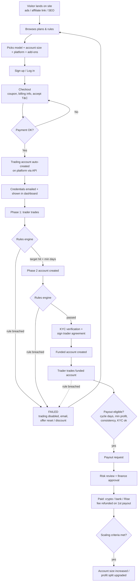
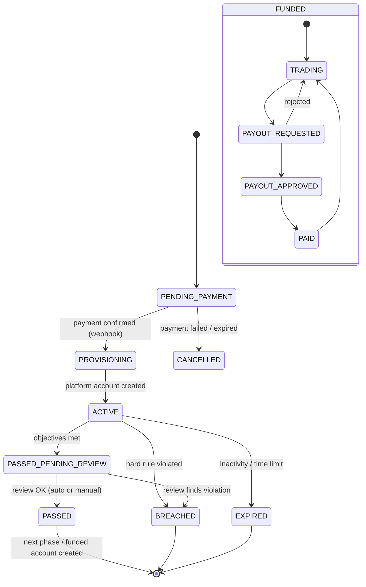
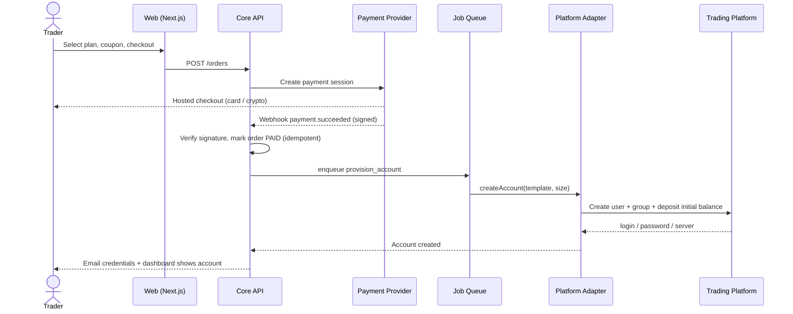
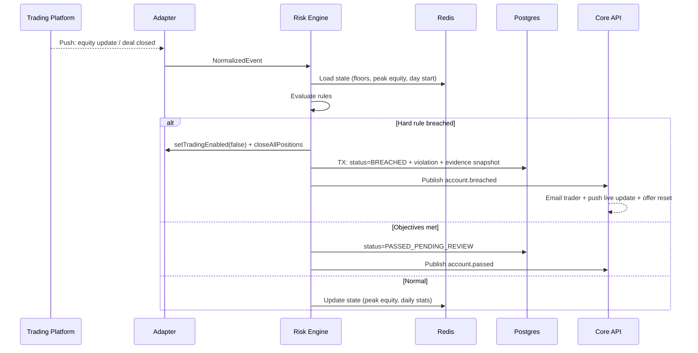
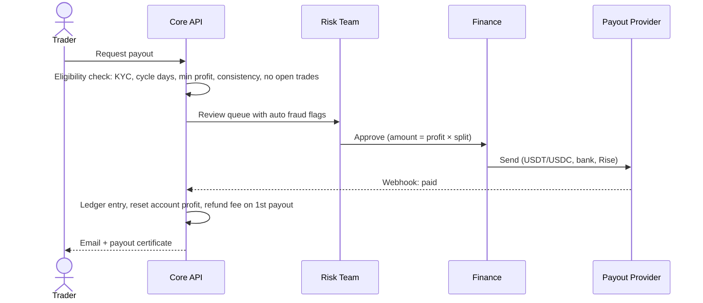

# Prop Firm Platform: Research & Technical Blueprint

> **Purpose:** Explain how a prop trading firm website works (business, user flow, rules, architecture, tech stack) before writing any code.
> **Research date:** September 2026. Covers FTMO, FundedNext, The5ers, FundingPips, Topstep, and vendors such as Match-Trader, cTrader, DXtrade, TradeLocker, Rithmic, YourPropFirm, PropAccount, Confirmo, Rise, and Sumsub.
> **Diagrams:** Flowcharts use Mermaid. They render on GitHub. In VS Code, install the *"Markdown Preview Mermaid Support"* extension.

---

## Table of Contents

1. [TL;DR](#1-tldr)
2. [What a Prop Firm Actually Is (Business Model)](#2-what-a-prop-firm-actually-is-business-model)
3. [Competitor Research Snapshot](#3-competitor-research-snapshot)
4. [The Website Flow (User Journey)](#4-the-website-flow-user-journey)
5. [The Challenge Rules Engine (Heart of the System)](#5-the-challenge-rules-engine-heart-of-the-system)
6. [Build vs Buy: The Most Important Decision](#6-build-vs-buy-the-most-important-decision)
7. [Trading Platform Options](#7-trading-platform-options)
8. [System Architecture](#8-system-architecture)
9. [Recommended Tech Stack](#9-recommended-tech-stack)
10. [Third-Party Services](#10-third-party-services)
11. [Security & Anti-Fraud](#11-security--anti-fraud)
12. [Legal & Compliance Notes](#12-legal--compliance-notes)
13. [MVP Scope & Roadmap](#13-mvp-scope--roadmap)
14. [Rough Cost Picture](#14-rough-cost-picture)
15. [Questions to Ask the Client Before Coding](#15-questions-to-ask-the-client-before-coding)
16. [Glossary](#16-glossary)
17. [Sources](#17-sources)

---

## 1. TL;DR

- **A prop firm sells trading "challenges".** A trader pays a one-time fee and trades a simulated account under strict rules (profit target, daily loss limit, max loss). If they pass, they get a "funded" account and keep 80–95% of the profits it makes.
- **You do NOT build the trading platform.** Charts, order execution, price feeds and mobile apps come from a licensed platform: **MT5, cTrader, Match-Trader, DXtrade or TradeLocker** for CFDs, and **Rithmic, Tradovate or others** for futures. You connect to it through its API.
- **You DO build:** the marketing website, trader dashboard, admin/back-office CRM, **the rules/risk engine**, checkout, KYC, payouts and affiliates.
- **The rules engine is the core of the product.** It watches every account's equity in real time and automatically passes or fails traders. A bug there costs your client money and their reputation.
- **Recommended stack:** TypeScript monorepo with **Next.js** (site, dashboard, admin), **NestJS** (API), **PostgreSQL** (+ TimescaleDB), **Redis + BullMQ** (live state and jobs), a separate **risk engine service**, and a **platform adapter layer** so more trading platforms can be added later.
- **Start the vendor contracts (trading platform, payment provider, KYC) on day one.** Approvals take weeks and are usually the real bottleneck, not the code.

---

## 2. What a Prop Firm Actually Is (Business Model)

### 2.1 How the money flows

```
 Trader pays fee ($30 – $1,000+)          Firm pays "rewards" (80–95% split)
          │                                              ▲
          ▼                                              │
 ┌─────────────────┐   pass    ┌─────────────────┐   pass   ┌───────────────────┐
 │  Phase 1        │ ────────► │  Phase 2        │ ───────► │  Funded account   │
 │  (evaluation)   │           │  (verification) │          │  (profit sharing) │
 └────────┬────────┘           └────────┬────────┘          └─────────┬─────────┘
          │ fail (most traders)         │ fail                        │ breach
          ▼                             ▼                             ▼
     Fee kept by firm  ◄──────── Retry / Reset (buy again, often with a discount)
```

- **Evaluation fees are the main revenue.** For example, FundedNext's Stellar 2-Step $6K account is listed at $59.99, or $29.99 with a promo code.
- **Most traders fail the evaluation.** Their fees fund the business and the payouts to successful traders.
- **Funded accounts at most retail CFD firms are simulated.** FundedNext says it directly: *"Funded Account – Trade simulated capital."* The firm pays the trader's profit share out of its own revenue. Some firms copy their consistently profitable traders into real broker accounts ("A-booking") to hedge.
- **Extra revenue comes from resets, add-ons and upgrades.** Examples: a higher profit split, faster payouts, removing minimum trading days, or a 95% split add-on.
- **Refunding the fee on the first payout** is a common marketing hook.

### 2.2 Metrics the client will care about (the admin dashboard must show these)

| Metric | Meaning |
|---|---|
| Pass rate (per model and phase) | % of accounts that pass each phase |
| Funded conversion | % of buyers who reach a funded account |
| **Payout ratio** | Total payouts ÷ total fee revenue. **The #1 survival metric.** |
| Revenue / orders / AOV | Sales performance |
| Affiliate CAC | Cost to acquire a trader through affiliates or ads |
| Exposure | Open risk across all funded accounts, by symbol |

### 2.3 Two different markets

| | **CFD / Forex prop** | **Futures prop** |
|---|---|---|
| Examples | FTMO, FundedNext, The5ers, FundingPips | Topstep, Apex, FundedNext Futures |
| Instruments | Forex, gold, indices, crypto CFDs, stocks | CME futures (ES, NQ, CL, GC…) |
| Platforms | MT5, cTrader, Match-Trader, DXtrade, TradeLocker | Rithmic, Tradovate, NinjaTrader, CQG, in-house (TopstepX) |
| Drawdown style | Mostly static daily and max loss | Mostly end-of-day (EOD) trailing drawdown |
| Notes | Easier to launch | Exchange data licensing; US regulatory attention |

**➡ Confirm with the client which one they want. It changes the platform, the rules and the vendors.**

---

## 3. Competitor Research Snapshot

| Firm | Market | Models | Example rules (published) | Notable |
|---|---|---|---|---|
| **FTMO** | CFD + Futures | 1-Step, 2-Step | **2-Step:** 10% → 5% target, 5% daily loss, 10% **static** max loss, min 4 trading days per phase. **1-Step:** 10% target, 3% daily loss, 10% **EOD trailing** max loss, 50% "Best Day" consistency rule | Separate rulebooks for CFD and futures. Futures uses EOD trailing drawdown and a 4:10 pm ET flat time. |
| **FundedNext** | CFD + Futures | Stellar 1-Step, 2-Step, Lite, Instant | **2-Step:** 8% → 5% target, 5% daily, 10% static max, min 5 days, 80% split (up to 90%, or 95% with add-on), first withdrawal after 21 days then every 14. **1-Step:** 10% target, 3% daily, 6% static | Pays a 15% "challenge phase reward". Fee refunded with first reward. Daily limit resets at 0:00 server time and counts floating P/L, swaps and commissions. |
| **The5ers** | CFD | Several programs | Industry ranges it publishes: target 8–10% (P1) and 4–5% (P2), daily loss 3–5%, max DD 8–10%, 5–10 minimum days | Publishes a lot of educational content on drawdown models. |
| **FundingPips** | CFD | Multiple | Similar 2-step structure | Lost MT5 access in Feb 2024 (MetaQuotes restrictions) and moved to **Match-Trader, cTrader and TradeLocker**. Later got its own MT5 license. **Lesson: support multiple platforms.** |
| **Topstep** | Futures | Evaluation → Funded | EOD-style rules | Runs its own platform, **TopstepX**, originally built by ProjectX. Uses an NFA-registered introducing broker entity for its live funded operations. |

### Common patterns across these websites

1. **Plan selector on the homepage.** The visitor picks a model, account size and platform, then sees the rules and price and clicks **"Start Challenge"**.
2. **Rules shown in full on every plan card**, plus a dedicated "Trading Rules" page.
3. **Heavy use of discount codes** (up to 50% off is common) and seasonal sales.
4. **Trust signals everywhere:** total paid out, trader count, Trustpilot rating, payout proofs, shareable certificates.
5. **"How it works" in 4 steps:** Pay fee → Pass evaluation → Get funded → Get rewards.
6. **Growth features:** affiliate program, leaderboard, free trials, competitions, Discord community.
7. **Large FAQ and help center.** There are many rules, and traders ask about them constantly.
8. **Careful wording:** "reward" instead of "salary" or "profit", and "simulated capital" (see [Legal](#12-legal--compliance-notes)).

---

## 4. The Website Flow (User Journey)

### 4.1 Public website sitemap

```
/                         Home: hero, how it works, plan selector, stats, testimonials, FAQ
/challenges               All programs
/challenges/[model]       Model detail (1-step, 2-step, instant): rules table, prices per size
/trading-rules            Full rulebook (daily loss, max loss, news, weekend, prohibited strategies)
/scaling-plan             How funded accounts grow
/payouts                  Payout process, methods, payout proofs
/leaderboard              Top traders
/competitions             Free trading competitions
/affiliate                Affiliate program landing page
/faq  /help               Help center
/blog                     Education and SEO content
/about  /contact
/legal/terms  /legal/privacy  /legal/risk-disclosure  /legal/refund
/legal/restricted-countries  /legal/aml-kyc  /legal/cookies
/signup  /login  /forgot-password  /2fa
/checkout                 Plan summary, add-ons, coupon, billing, T&C acceptance, payment
```

### 4.2 End-to-end trader journey



### 4.3 Account lifecycle (state machine)

Build this as an explicit state machine in code. Every transition is logged with who or what triggered it.



### 4.4 Trader dashboard (client area) features

| Area | Features |
|---|---|
| **Accounts** | List of all accounts: phase, status, balance, equity, platform, login and server credentials |
| **Account metrics** | Progress bars for each objective (profit target, daily loss left, max loss left, trading days). Equity and balance curve. Daily P/L calendar. Trade history/journal. Stats: win rate, average win/loss, profit factor, expectancy, best-day %, lots, instrument breakdown. **Live updates over WebSocket.** |
| **Shop** | Buy a challenge, reset, add-ons, upgrade |
| **Verification** | KYC status, e-signed trader agreement |
| **Payouts** | Eligibility countdown, request payout, history, payout method setup |
| **Certificates** | "Challenge Passed" and "Payout" certificates, shareable on social media |
| **Affiliate** | Referral link, clicks, conversions, commissions, withdrawals |
| **Community** | Leaderboard, competitions |
| **Tools** | Economic calendar (for news rules), risk/lot-size calculator |
| **Account settings** | Profile, 2FA, notification preferences, invoices/orders |
| **Support** | Tickets, live chat, help center |

### 4.5 Admin / back-office features

| Module | Features |
|---|---|
| **KPI dashboard** | Revenue, orders, pass rates, funded count, **payout ratio**, pending payouts, active accounts, exposure |
| **Trader CRM** | One record per trader: accounts, orders, KYC, payouts, notes, IP/device history, full audit trail |
| **Challenge builder** | Create templates (phases, rules, prices per size, platforms, add-ons) **without code deploys** |
| **Account management** | Manual pass/fail/reinstate, extend, reset, adjust balance, disable, change phase |
| **Risk console** | Accounts close to breaching, fraud flags, exposure by symbol, top funded traders, A-book copy list |
| **Payout queue** | Review → approve/reject → batch → mark paid → reconcile |
| **Orders & payments** | Refunds, chargebacks, failed payments |
| **Coupons & promotions** | Codes, usage limits, expiry, affiliate-linked codes, flash sales |
| **KYC review** | Manual review of flagged verifications |
| **Affiliates** | Tiers, commission rules, approvals, commission payouts |
| **Content** | FAQ, rules pages, announcements, banners (via CMS) |
| **Competitions** | Create competitions, manage entries and prizes |
| **Notifications** | Email templates, broadcast messages |
| **Settings** | Restricted countries, platform config, server timezone, news blackout windows |
| **RBAC** | Roles: Super Admin, Support, Risk, Finance, Marketing. **Every admin action goes to the audit log.** |

---

## 5. The Challenge Rules Engine (Heart of the System)

### 5.1 The rules you must support

| Rule | What it means | Typical values | Effect |
|---|---|---|---|
| **Profit target** | Closed profit ≥ X% of initial balance | P1: 8–10%, P2: 4–5% | Objective (pass) |
| **Daily loss limit** | Equity can't drop more than X% of the *initial* balance below the day's starting reference | 3–5% | **Hard breach** |
| **Max loss (static)** | Equity can't drop below `initial × (1 − X%)` | 6–10% | **Hard breach** |
| **Max loss (trailing)** | Floor rises with peak equity (often stops rising once it reaches the initial balance) | 4–6% | **Hard breach** |
| **Max loss (EOD trailing)** | Floor rises only from end-of-day balance (common in futures) | varies | **Hard breach** |
| **Min trading days** | Number of distinct days with at least one trade | 0–5 | Objective |
| **Time limit** | Must pass within N days (many firms have removed this) | none / 30 / 60 | Expire |
| **Consistency / Best Day** | Best day's profit ≤ X% of total positive-day profit | 40–50% | Objective or payout condition |
| **Max risk per trade** | For example FundedNext: max 3% risk at any time on funded accounts | 1–3% | Soft or hard |
| **News trading** | No opening/closing trades within ±N minutes of high-impact news (often funded accounts only) | ±2–5 min | Profit removed or warning |
| **Weekend holding** | Positions held over the weekend allowed or not | per model | Soft or hard |
| **Inactivity** | No trade for N days → account closed | 30 days | Expire |
| **Prohibited strategies** | HFT, latency arbitrage, tick scalping, copying other traders, hedging across accounts, account management by third parties | – | Manual review → breach |

### 5.2 Formulas (pseudo-code)

```ts
const initial = account.initialBalance;

// DAILY LOSS: reset at server midnight (some firms use max(balance, equity) at midnight)
const dayStartRef = account.balanceAtServerMidnight;
const dailyFloor  = dayStartRef - rules.dailyLossPct * initial;
if (equity <= dailyFloor) breach("DAILY_LOSS");       // equity = balance + floating P/L - swaps - commissions

// MAX LOSS: STATIC
const staticFloor = initial * (1 - rules.maxLossPct);

// MAX LOSS: TRAILING (intraday high-water mark)
state.peakEquity  = Math.max(state.peakEquity, equity);
const trailFloor  = Math.min(state.peakEquity - rules.maxLossPct * initial, initial); // locks at initial

// MAX LOSS: EOD TRAILING (updated only by the end-of-day job)
// onServerEOD: state.eodPeak = max(state.eodPeak, closingBalance)
const eodFloor    = Math.min(state.eodPeak - rules.maxLossPct * initial, initial);

if (equity <= activeMaxLossFloor) breach("MAX_LOSS");

// PASS CHECK: run on every closed deal
const passed =
  closedBalance >= initial * (1 + rules.profitTargetPct) &&
  tradingDays   >= rules.minTradingDays &&
  (!rules.requireFlat || openPositions === 0) &&
  (!rules.consistencyPct || bestDayProfit <= rules.consistencyPct * totalPositiveDaysProfit);
```

### 5.3 Engineering rules for the engine

1. **Check hard limits on every equity change, not just on trades.** A floating loss can breach the daily limit while no trade is being placed. You need live equity from the platform's push stream, or you compute it yourself from open positions × live prices.
2. **Use platform-side risk as a safety net.** Match-Trader, Rithmic and ProjectX-style platforms have built-in auto-liquidation and daily loss locks. Configure them where available. Your engine stays the source of truth.
3. **Store rules as data, and version them.** Keep rules as JSON per challenge template. Each account stores a *snapshot* of the rules it was sold with. Changing a template must never change the rules of accounts already sold.
4. **Pick one server timezone and document it.** Forex brokers usually run GMT+2/+3 so daily candles line up with the New York close. The daily reset job must handle daylight saving time.
5. **Process each breach exactly once.** Use a DB transaction plus a unique constraint on `(account_id, event_type)`. Webhooks and streams can deliver duplicates.
6. **Save the evidence on every breach:** equity, balance, open positions, prices and timestamp. Traders will dispute breaches, and support needs proof.
7. **Run a reconciliation job every few minutes.** It re-pulls account state from the platform in case a stream event was missed.
8. **Unit-test the engine heavily.** Cover every rule with edge cases: exactly at the limit, DST switch, swaps charged at rollover, partial closes, gaps over the weekend.
9. **Write the T&C and the engine from the same spec.** The Terms & Conditions *are* the specification. The code must do exactly what the legal text says.

---

## 6. Build vs Buy: The Most Important Decision

### 6.1 What to build vs license

| Layer | Build it? | Why |
|---|---|---|
| Trading platform (charts, execution, price feed, mobile apps) | ❌ **Never** | Years of work, exchange/data licensing, regulation. License a white-label platform instead. |
| Market data, liquidity, demo execution | ❌ | Comes with the platform. |
| Marketing website | ✅ | This is the brand and the conversion funnel. |
| Trader dashboard + admin CRM | ✅ (or license) | This is where the client differentiates. |
| Rules / risk engine | ✅ (or use the platform's prop module) | Core IP, needs full control. |
| Payments, KYC, payouts, email | 🔌 Integrate | Use specialist providers. |

### 6.2 The three options for the client

| Option | What it is | Pros | Cons |
|---|---|---|---|
| **A. Full turnkey white label** | e.g. PropAccount (from $3,000 setup + 50% net revenue share) or YourPropFirm "Prop Suite" ($2,749 setup + 50% revenue share) | Live in about a week, very cheap to start | Gives away half the revenue, little customization, vendor lock-in. **You would only build the marketing site.** |
| **B. Custom platform on licensed trading tech** ⭐ | Build website + dashboard + admin + risk engine. Connect to a white-label trading platform through its API. | Client owns the code, **no revenue share**, full customization, can add platforms | Longest build, and you own reliability and correctness |
| **C. Hybrid** | Use a platform with a built-in prop module (e.g. Match-Trader has built-in challenges plus a Prop CRM). Build a custom site and extras on top. | Faster than B, less risk | Less control. Rules are limited to what the vendor supports. |

**Since you were hired to build the software, this document assumes Option B.** It is still worth showing the client A and C so they choose knowingly. Some clients start with C and move to B later.

---

## 7. Trading Platform Options

| Platform | Market | Integration API | Notes |
|---|---|---|---|
| **MetaTrader 5** (MetaQuotes) | CFD | **Manager API** (C++/.NET DLL, runs on Windows), Web API. Community REST wrappers exist. | Traders know it best. **In early 2024 MetaQuotes restricted prop firms without direct agreements**, and firms serving US clients were hit hardest. Requires a direct license or a broker partner. Heaviest integration. |
| **cTrader** (Spotware) | CFD | Broker-side Manager API for licensees. **Open API** (JSON/Protobuf over TCP/WebSocket) for trader-facing apps. | 40+ prop firms in its ecosystem. Modern and well documented. |
| **Match-Trader** (Match-Trade Technologies) | CFD + Futures | Broker & Platform APIs: **REST + WebSocket (STOMP)**, database access | Built-in prop challenges and a Prop CRM, TradingView charts, white label from **$2,500**, "start your prop firm in 1 week". Works with external CRMs. |
| **DXtrade** (Devexperts) | CFD + Futures | **REST API**, **Push API (WebSocket)**, FIX API | Has a dedicated prop trading technology offering. |
| **TradeLocker** | CFD | APIs + partner ecosystem | TradingView charts and a built-in risk calculator. Popular with discretionary traders. |
| **Rithmic** | Futures | 3 API options. **Server-side risk management and auto-liquidation.** | Positions itself for "funding evaluators". Scales from 4 to 40,000+ accounts. Runs underneath many futures prop firms. |
| Tradovate / NinjaTrader / CQG | Futures | APIs | Common alternatives for futures. |
| ~~ProjectX~~ | Futures | – | **Wound down its third-party offering. Partner support ended Feb 28, 2026.** Don't plan around it. |

**Recommendation:**
- **Launch with ONE platform.** For CFDs, **Match-Trader or cTrader** are common choices for new firms, have modern APIs, and target prop firms directly. Add MT5 later if the client secures a license.
- **Put every platform behind a `PlatformAdapter` interface from day one**, so adding a second platform means writing one new adapter:

```ts
interface PlatformAdapter {
  createAccount(input: { userId: string; group: string; balance: number; leverage: number }): Promise<PlatformAccount>;
  setTradingEnabled(login: string, enabled: boolean): Promise<void>;
  closeAllPositions(login: string): Promise<void>;
  adjustBalance(login: string, amount: number, comment: string): Promise<void>;
  getAccountState(login: string): Promise<{ balance: number; equity: number; positions: Position[] }>;
  getDeals(login: string, from: Date, to: Date): Promise<Deal[]>;
  subscribe(handler: (e: NormalizedEvent) => void): Unsubscribe; // equity updates, deals, positions
  resetPassword(login: string): Promise<string>;
}
```

---

## 8. System Architecture

### 8.1 High-level diagram

```
                     ┌──────────────── Cloudflare (DNS · WAF · DDoS · Turnstile bot protection) ────────────────┐
                                │                           │                               │
                      ┌─────────▼────────┐        ┌─────────▼────────┐            ┌─────────▼─────────┐
                      │  Marketing Site  │        │ Trader Dashboard │            │    Admin Panel    │
                      │  Next.js SSR/SSG │        │  Next.js app     │            │  Next.js, 2FA,    │
                      │  + CMS (SEO)     │        │  live via WS     │            │  IP allowlist     │
                      └─────────┬────────┘        └─────────┬────────┘            └─────────┬─────────┘
                                └──────────── REST / WebSocket ─────────────────────────────┘
                                                            │
                                               ┌────────────▼────────────┐
                                               │     Core API (NestJS)   │  auth · users · products · orders
                                               │   REST + WS gateway     │  accounts · payouts · affiliates · KYC
                                               └───┬────────┬─────────┬──┘
                                                   │        │         │
                        ┌──────────────────────────┘        │         └──────────────────────────┐
                        ▼                                   ▼                                    ▼
             ┌─────────────────────┐            ┌──────────────────────┐            ┌──────────────────────┐
             │   PostgreSQL        │            │   Redis              │            │  Job Workers (BullMQ)│
             │   source of truth   │            │   cache · sessions   │            │  provisioning · email│
             │   + TimescaleDB     │            │   live account state │            │  daily reset · PDFs  │
             │   (equity series)   │            │   queues · pub/sub   │            │  payout batches      │
             └─────────────────────┘            └──────────▲───────────┘            └──────────────────────┘
                                                           │
                                               ┌───────────┴───────────┐
                                               │     Risk Engine       │  evaluates rules on every equity /
                                               │  (separate service)   │  deal event → breach / pass events
                                               └───────────▲───────────┘
                                                           │ normalized events
                                               ┌───────────┴───────────┐
                                               │   Platform Adapters   │  MT5 · cTrader · Match-Trader · DXtrade
                                               │  (ingest + control)   │  create · disable · close-all · stream
                                               └───────────▲───────────┘
                                                           │ Manager / Broker API · WebSocket push
                                               ┌───────────┴───────────┐
                                               │   Trading Platform    │  licensed white label: charts,
                                               │   servers (vendor)    │  execution, price feed, mobile apps
                                               └───────────────────────┘

 External (webhooks into Core API):  Card PSP · Crypto gateway · KYC provider · Payout provider
 Outbound:  Email (Resend/Postmark/SES) · Analytics (GA4/PostHog) · Monitoring (Sentry/Grafana)
```

### 8.2 Services breakdown

| Service | Responsibility | Scaling notes |
|---|---|---|
| **Marketing site** | SEO pages, plan selector, blog, legal | Static/SSR, CDN cached |
| **Trader dashboard** | Everything a logged-in trader does | Live equity over WebSocket |
| **Admin panel** | Back office. Deploy separately and lock it down. | Internal users only |
| **Core API** | Business logic, auth, webhooks from PSP/KYC, REST + WS | Stateless, scale horizontally |
| **Platform adapters** | One per trading platform. Translates platform events into `NormalizedEvent`s and executes commands. | One process per platform server connection |
| **Risk engine** | Holds per-account state in Redis. Evaluates rules. Emits `account.breached` and `account.passed`. | Shard by `account_id` to scale |
| **Workers** | Account provisioning, emails, daily/EOD reset, certificates, payout batches, reconciliation, reports | BullMQ with retries and dead-letter queue |
| **PostgreSQL** | Users, orders, accounts, trades, payouts, ledger, audit log | Managed, with point-in-time recovery |
| **TimescaleDB** | Equity snapshots and time-series data for charts and disputes | Hypertables with retention policies |
| **Redis** | Live state, cache, queues, pub/sub for WebSocket fan-out | Managed, persistence on |

### 8.3 Key flows

**Purchase → account provisioning**



**Live monitoring → breach or pass**



**Payout**



### 8.4 Core data model

> Store money as **integer cents or `NUMERIC`**, never floating point. Use a **double-entry ledger** for payouts and affiliate commissions.

```
users                (id, email, password_hash, name, country, twofa_secret, status, referred_by, created_at)
user_ip_logs         (user_id, ip, device_fingerprint, user_agent, created_at)    ← anti-fraud
kyc_verifications    (user_id, provider, applicant_id, status, reviewed_at)
agreements           (user_id, type, version, signed_at, ip)

challenge_templates  (id, name, type[1step|2step|instant], version, active)
template_phases      (template_id, phase_no, rules_json)       ← profit target, DD %, DD type, min days…
products             (id, template_id, account_size, platform, price, currency, active)
addons               (id, name, effect_json, price)
coupons              (code, type, value, max_uses, expires_at, affiliate_id)

orders               (id, user_id, product_id, addons, coupon_id, amount, currency, status, psp, psp_ref)
payments             (order_id, provider, provider_txn_id, status, raw_webhook, created_at)

trading_accounts     (id, user_id, order_id, template_id, phase_no, rules_snapshot_json,
                      platform, platform_login, server, initial_balance, status,
                      parent_account_id, started_at, ended_at)
account_daily_stats  (account_id, date, start_balance, start_equity, end_balance,
                      min_equity, max_equity, pnl, trade_count)
equity_snapshots     (account_id, ts, balance, equity)          ← TimescaleDB hypertable
trades               (account_id, platform_deal_id, symbol, side, volume, open_time, close_time,
                      open_price, close_price, sl, tp, profit, commission, swap)
rule_violations      (account_id, rule, value, threshold, evidence_json, is_hard, ts)

payouts              (id, account_id, user_id, gross_profit, split_pct, amount, method,
                      destination, status, reviewed_by, paid_at, tx_ref)
ledger_entries       (id, account_ref, debit, credit, currency, reference_type, reference_id, ts)

affiliates           (user_id, tier, commission_pct, status)
affiliate_clicks     (affiliate_id, ip, landing_url, utm, ts)
affiliate_commissions(affiliate_id, order_id, amount, status)

certificates         (user_id, account_id, type, image_url, created_at)
competitions / competition_entries / tickets / notifications
audit_logs           (actor_id, action, entity, entity_id, before_json, after_json, ip, ts)
```

---

## 9. Recommended Tech Stack

| Layer | Recommendation | Why | Alternatives |
|---|---|---|---|
| Language | **TypeScript everywhere** | One language for web, API and workers. Shared types. | PHP/Laravel (common in broker CRMs). Go for the risk engine at scale. |
| Monorepo | **Turborepo + pnpm** | Shared `db`, `types`, `ui`, `rules` packages | Nx |
| Marketing site | **Next.js (App Router)** + Tailwind + shadcn/ui + Framer Motion | Prop sites are marketing-heavy and need SEO and speed | Astro |
| CMS | **Payload CMS** (runs inside Next.js) or Sanity | Marketing edits FAQ, rules and blog without developers | Strapi |
| Dashboard & Admin | Next.js + TanStack Query + TanStack Table + shadcn/ui | Fast to build rich dashboards | React + Vite |
| Charts | **TradingView Lightweight Charts** (equity curves) + Recharts/ECharts (stats) | Looks like trading software | – |
| Backend API | **NestJS** (REST + WebSocket gateway) with Zod validation | Modules and dependency injection suit a large domain | Fastify, Laravel |
| ORM | **Prisma** or **Drizzle** | Type-safe DB access and migrations | TypeORM |
| Database | **PostgreSQL 16+** (managed: AWS RDS, Neon, Supabase) | ACID transactions for money | – |
| Time series | **TimescaleDB** extension | Equity snapshots, charts, dispute evidence | ClickHouse (later, for analytics) |
| Cache / queues / live state | **Redis + BullMQ** | Live account state, job retries, scheduled jobs | RabbitMQ, NATS |
| Realtime | **Socket.IO** (Redis adapter) or native WS | Live equity and breach notifications | Ably, Pusher |
| Risk engine | Separate **Node.js/TS service**, sharded by account | Same language as the rest; rewrite hot paths in Go only if needed | Go, Rust |
| Auth | **Better Auth** or custom JWT/refresh tokens + **TOTP 2FA** + email verification | Full control, no per-user fees | Clerk, Auth.js |
| Files | **S3 / Cloudflare R2** | Invoices, certificates, exports | – |
| Certificates / PDFs | Playwright or `satori` / `@vercel/og` | Shareable images and PDFs | – |
| Email | **Resend + React Email** (or Postmark / Amazon SES) | Deliverability plus templates in code | SendGrid |
| Hosting | **Docker** on AWS (ECS Fargate), or Hetzner/DigitalOcean for cost. Place servers near the trading platform's servers (e.g. London/Frankfurt). | Low latency to platform APIs | Kubernetes (later) |
| Edge / security | **Cloudflare** (DNS, WAF, DDoS, Turnstile) | Prop firms get attacked and botted | – |
| Observability | **Sentry**, Grafana + Prometheus + Loki, uptime monitor (BetterStack) | You must know when the risk engine lags | Datadog |
| Analytics | GA4 + GTM (ads and affiliate pixels), **PostHog** (funnels) | Conversion tracking | Mixpanel |
| Support | Crisp or Intercom live chat, Discord community | Industry standard | Zendesk |
| CI/CD | GitHub Actions | – | GitLab CI |
| Testing | **Vitest** (heavy rules-engine coverage), **Playwright** E2E | Correctness of rules is critical | Jest, Cypress |

### Suggested repo layout

```
prop-platform/
├── apps/
│   ├── web/            # marketing site + trader dashboard (Next.js)
│   ├── admin/          # admin panel (Next.js, deployed separately)
│   ├── api/            # NestJS core API + WS gateway
│   ├── risk-engine/    # rules evaluation service
│   ├── adapters/       # platform adapters (matchtrader/, ctrader/, mt5/, dxtrade/)
│   └── workers/        # BullMQ jobs
├── packages/
│   ├── db/             # Prisma/Drizzle schema + migrations
│   ├── rules/          # PURE rules functions (shared, heavily tested)
│   ├── types/          # shared DTOs, NormalizedEvent, enums
│   ├── ui/             # shared shadcn components
│   └── emails/         # React Email templates
└── infra/              # docker-compose, IaC, CI
```

> 💡 Keep `packages/rules` as **pure functions with no I/O**: `(state, event, rules) → { newState, decisions }`. The risk engine, the dashboard's "remaining drawdown" widget, and your tests all use the same code, so the numbers always match.

---

## 10. Third-Party Services

| Need | Options found in research | Notes |
|---|---|---|
| **Card payments** | High-risk merchant account / PSP | Mainstream processors (e.g. Stripe, PayPal) often treat prop challenges as restricted or high-risk. **Confirm with the provider before building around one.** Plan for chargebacks: 3-D Secure, clear billing descriptor, logged T&C acceptance. |
| **Crypto payments** | **Confirmo** (says it handles ~60% of global prop trading payment flows and shows FTMO and FundingPips on its site), NOWPayments, CoinGate, CoinsPaid, B2BinPay | No chargebacks. USDT/USDC dominate. |
| **Payouts** | **Rise** (stablecoin + fiat, handles KYC, contracts and tax docs, 190+ countries), Confirmo payouts, direct USDT/USDC, bank wire | Industry crypto payouts were reported at ~$115M in Q1 2026 alone |
| **KYC / AML** | **Sumsub** (has a trading-industry product), Veriff, Onfido | Common pattern: **KYC before the first funded account or payout**, not at signup, to reduce friction |
| **Agreements** | Built-in click-wrap with version, IP and timestamp logging, or Dropbox Sign/DocuSign | Needed before funded stage |
| **Economic calendar** | A news data API (e.g. Trading Economics, Financial Modeling Prep) | Drives the news-trading rule. Check the data license. |
| **Affiliates** | **Build in-house** (core growth channel) or Tapfiliate / FirstPromoter / PartnerStack | Needs per-affiliate geo restrictions (see Legal) |
| **Chat / help center** | Crisp, Intercom, Zendesk | – |
| **Reviews** | Trustpilot widget | Trust signal on the homepage |

---

## 11. Security & Anti-Fraud

### 11.1 Platform security checklist

- [ ] **2FA** available for traders, **mandatory for admins**. Admin panel behind an IP allowlist or VPN.
- [ ] **RBAC** plus an **immutable audit log** for every admin action (especially balance changes, pass/fail overrides and payouts).
- [ ] **Hosted checkout only.** Never touch raw card data, which keeps PCI scope minimal.
- [ ] **Verify webhook signatures** and use **idempotency keys** for every payment and KYC webhook.
- [ ] **Encrypt platform credentials** at rest. Keep secrets in a secrets manager, not `.env` files in production.
- [ ] Rate limiting plus **Cloudflare Turnstile** on signup, login, checkout and password reset.
- [ ] Money as integers or decimals. Double-entry ledger. Reconciliation reports.
- [ ] Automated backups with point-in-time recovery, and a tested restore procedure.

### 11.2 Fraud patterns to detect (these feed the payout review queue)

| Pattern | How to detect |
|---|---|
| **Multi-accounting** | Same IP, device fingerprint, card, crypto wallet or KYC identity across different users |
| **Cross-account hedging** | Opposite positions on the same symbol at the same time across accounts. One account fails, the other passes. |
| **Copy trading / signal groups** | Many accounts with near-identical trades within seconds |
| **HFT / tick scalping / latency arbitrage** | Very short hold times, unrealistic win rates, trades clustered on price spikes |
| **News straddling / gap trading** | Trades opened right before high-impact news or the market open |
| **One lucky oversized trade** | Consistency rule and max-risk-per-trade checks |
| **Payment fraud** | Card country ≠ IP country ≠ KYC country, velocity checks, chargeback history |
| **Restricted jurisdictions** | Geo-block by IP plus KYC country check plus sanctions screening |

---

## 12. Legal & Compliance Notes

> ⚠️ **Not legal advice.** The client needs a lawyer who knows prop trading and financial promotions in their target markets. These are points to raise with them.

1. **Be explicit that accounts are simulated.** In **August 2023 the CFTC sued My Forex Funds**, alleging among other things that it misrepresented simulated trading and acted as counterparty to customers' trades. About $310M was frozen. **In May 2025 the court dismissed the case because of the CFTC's own misconduct, not on the merits.** MFF began returning funds in April 2026. The lesson for the industry: **clear disclosure** of simulated vs real trading, and no hidden tricks (artificial slippage, secret rule changes).
2. **Wording matters.** Firms say "reward", "performance reward" and "simulated capital" instead of promising a job or a return on investment.
3. **Jurisdiction and platform access are linked.** MetaQuotes' 2024 restrictions pushed some firms to re-incorporate (for example, Funding Traders moved to Saint Lucia to get MT5 back). The client's company setup affects which platforms and PSPs will work with them.
4. **US traders:** futures prop firms like Topstep run regulated entities for parts of their business (Topstep has an NFA-registered introducing broker). CFD firms often restrict US clients. Decide per market.
5. **Geo-fencing is required.** Keep a restricted-countries list (sanctioned countries plus any the lawyer flags). Enforce it at signup, checkout, KYC **and per affiliate**, because an affiliate sending traffic from a restricted country creates exposure too.
6. **The T&C must match the code exactly.** Every rule definition, the refund policy, the dispute process and the payout conditions.
7. **Privacy:** GDPR if serving EU users (data export and deletion, cookie consent).
8. **Tax and contractor status for payouts:** providers like Rise handle contractor agreements and tax documents.

---

## 13. MVP Scope & Roadmap

### Phase 0: Discovery & vendor setup (start immediately)
- Answer the [client questions](#15-questions-to-ask-the-client-before-coding).
- **Sign up with the trading platform, PSPs and KYC provider now.** Approvals and onboarding take weeks.
- Write the **rules specification** (one document the T&C and the code both follow).
- Wireframes and brand/design system.

### Phase 1: MVP (launchable product)
- [ ] Marketing site: home, challenges, rules, FAQ, legal pages
- [ ] Auth: signup, login, email verification, 2FA
- [ ] Challenge templates: **1-Step + 2-Step**, products, coupons
- [ ] Checkout: **1 crypto gateway + 1 card PSP**
- [ ] **1 platform adapter** with auto-provisioning
- [ ] Risk engine: daily loss, max loss (static + trailing), profit target, min days, inactivity
- [ ] Trader dashboard: accounts, objectives, equity chart, trade history, live updates
- [ ] Phase progression → KYC gate → agreement → funded account
- [ ] Payout request → admin review → payment → ledger
- [ ] Admin: users, accounts, orders, payouts, templates, KPIs, audit log
- [ ] Transactional emails
- [ ] Monitoring and alerting on risk-engine lag

### Phase 2: Growth
- [ ] Affiliate program (multi-tier) and affiliate-linked coupons
- [ ] Certificates, leaderboard, free trial, competitions
- [ ] Resets, add-ons, **scaling plan**
- [ ] Consistency and news-trading rules with an economic calendar
- [ ] Fraud-detection dashboard
- [ ] Analytics: funnels, cohorts, payout ratio by model

### Phase 3: Scale
- [ ] Second platform (e.g. MT5) and/or a futures product
- [ ] Multi-language, multi-currency
- [ ] Mobile app or PWA
- [ ] A-book copying of top funded traders, plus an exposure dashboard
- [ ] AI trade-journal insights, retention automations

> **Rough order of magnitude:** an MVP like Phase 1 is typically a few months for a small team (2–3 developers). The actual timeline depends heavily on team experience, the chosen platform's API quality, and **how fast vendor approvals come through**. Treat this as a planning placeholder, not a quote.

---

## 14. Rough Cost Picture

Published or advertised prices found during research. **Confirm with each vendor; most have extra monthly fees or custom quotes.**

| Item | Price found | Source type |
|---|---|---|
| Match-Trader white label (platform) | From **$2,500** | Vendor site |
| PropAccount turnkey white label | From **$3,000** setup + **50% of net revenue** | Vendor site |
| YourPropFirm "Prop Suite" white label | **$2,749** setup, no monthly fee, **50% revenue share**. Enterprise tier is usage-based with no revenue share. | Vendor site |
| Brokeret Prop CRM (SaaS) | From **$1,000/mo** (up to 500 active accounts) | Vendor site |
| Rise payouts (Agent of Record model) | **$49 per contractor/month** | Vendor site |
| Custom build (what you're doing) | PropAccount claims custom builds "often exceed $50k–$150k" | Vendor marketing claim; treat with caution |
| KYC, crypto gateway, email, hosting | Usage-based (per verification, % of volume, per email, infra) | Get quotes |

---

## 15. Questions to Ask the Client Before Coding

**Business model**
1. CFD/forex, futures, or both?
2. Which models (1-Step, 2-Step, Instant Funding)? Account sizes, prices, and **exact rules**? Do they have a rules document?
3. Profit split, payout frequency, fee refund, scaling plan?
4. Will funded accounts be simulated? Any plan to A-book top traders?

**Legal & vendors**
5. Is the company registered? Where? Which countries will they serve or block? US traders?
6. Do they already have a **trading platform license** or broker partner? Which platform?
7. Which payment providers are approved already? Would crypto-only at launch be acceptable?
8. Payout methods (crypto, bank, Rise)?

**Product & scope**
9. Fully custom build (Option B), or are they open to licensing a prop CRM (Options A/C)?
10. Must-have features at launch vs later (affiliates, competitions, certificates, free trial)?
11. Branding, design, domain ready? Languages?
12. Who runs operations (support, risk review, finance approvals)? This defines the admin roles.

**Scale, money & ownership**
13. Expected accounts in year 1? (For infrastructure sizing)
14. Budget and target launch date?
15. Who owns the code, hosting accounts and vendor contracts? Who maintains it after launch (SLA)?

---

## 16. Glossary

| Term | Meaning |
|---|---|
| **Challenge / Evaluation** | Paid test phase(s) a trader must pass |
| **Phase 1 / Phase 2** | Evaluation and verification stages of a 2-step challenge |
| **Funded account** | Account the trader earns profit share on after passing (usually simulated) |
| **Balance** | Account value from closed trades only |
| **Equity** | Balance + floating P/L of open trades |
| **Drawdown (DD)** | Drop from a reference point (initial balance, day start, or peak) |
| **Static DD** | Floor fixed relative to the initial balance |
| **Trailing DD** | Floor moves up as equity makes new highs |
| **EOD trailing DD** | Floor moves up only at end of day |
| **Daily loss limit** | Max loss allowed within one server day |
| **Consistency / Best Day rule** | Limits how much of the total profit can come from one day |
| **Profit split / Reward share** | Trader's % of profit (80–95%) |
| **Reset** | Paying again to restart a failed or ongoing challenge |
| **Scaling plan** | Increasing the funded account size after consistent profits |
| **A-book / B-book** | Trades routed to real market vs kept internal/simulated |
| **EA** | Expert Advisor: automated trading bot (MT4/MT5) |
| **HFT / latency arbitrage** | Ultra-fast strategies that exploit feed delays. Usually banned. |
| **Server time** | The platform's clock that defines "day" boundaries for daily rules |
| **PSP** | Payment Service Provider |
| **KYC / AML** | Know Your Customer / Anti-Money Laundering checks |
| **White label** | Licensed software rebranded as your own |

---

## 17. Sources

**Prop firms (rules, flows)**
- FundedNext – How it works: https://fundednext.com/how-it-works
- FundedNext – CFD challenges & pricing: https://fundednext.com/cfds
- FundedNext – General trading rules: https://fundednext.com/general-rules/cfds/trading-objectives
- FTMO rules overview (CFD vs futures, 2026): https://proptradingvibes.com/blog/ftmo-rules-overview
- The5ers – Drawdown rules explained (2026): https://the5ers.com/prop-firm-drawdown-rules-explained-daily-max-and-trailing-limits-in-2026
- The5ers – What is a prop firm evaluation (2026): https://the5ers.com/what-is-a-prop-firm-evaluation-challenges-phases-and-rules-explained
- Topstep – TopstepX: https://www.topstep.com/topstepx

**Trading platforms & APIs**
- Match-Trader prop solution: https://prop.match-trader.com/ · https://match-trader.com/prop-trading-platform
- Match-Trader white label pricing: https://match-trader.com/white-label/
- Match-Trader Platform API: https://match-trader.com/platform-api/
- Match-Trader Prop CRM: https://match-trader.com/prop-trading-crm-client-office-for-prop-firms
- cTrader Open API: https://help.ctrader.com/open-api · cTrader prop firms: https://ctrader.com/prop-firms
- DXtrade developer portal: https://demo.dx.trade/developers
- TradeLocker – Open a prop firm: https://tradelocker.com/open-a-prop-firm/
- Rithmic: https://www.rithmic.com/
- ProjectX (wind-down notice): https://www.projectx.com/
- MT5 returns to prop firms after MetaQuotes restrictions: https://www.financemagnates.com/forex/mt5-returns-to-prop-firm-funding-traders-after-saint-lucia-registration

**Prop CRMs / white labels**
- YourPropFirm: https://yourpropfirm.com/ · https://yourpropfirm.com/platform
- PropAccount pricing: https://propaccount.com/pricing
- Brokeret Prop CRM pricing: https://brokeret.com/prop-crm/pricing
- PropFirmCRM features: https://www.propfirmcrm.com/features

**Payments, payouts, KYC**
- Confirmo – Prop trading: https://confirmo.com/industries/prop-trading
- Rise – Payroll for prop firms: https://www.riseworks.io/blog/best-payroll-platform-for-prop-firms-in-2026
- CoinGate – Crypto payouts for prop firms: https://coingate.com/blog/post/crypto-payouts-for-prop-firms
- Sumsub – KYC for trading: https://sumsub.com/trading

**Regulation**
- CFTC complaint vs Traders Global (My Forex Funds): https://www.cftc.gov/media/9196/enftradersglobalgroupcomplaint082923/download
- JD Supra – MFF case dismissal analysis: https://www.jdsupra.com/legalnews/my-forex-funds-lawsuit-warning-to-the-4332455/
- FX News Group – MFF begins returning funds (Apr 2026): https://fxnewsgroup.com/forex-news/retail-forex/prop-firm-myforexfunds-begins-returning-client-funds-following-court-vindication
- NexusFi – Prop firm regulatory status: https://nexusfi.com/a/prop-firms/prop-firm-regulatory-status
